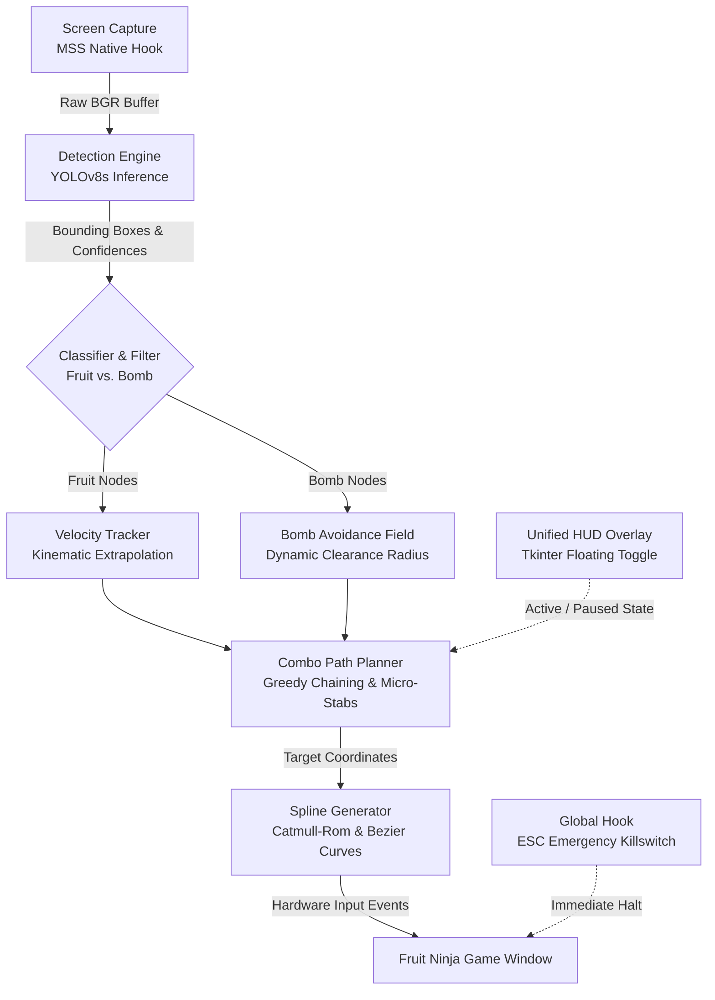

# Fruit Ninja Automation Bot 🍉🥷

An advanced, real-time autonomous computer vision bot designed to play Fruit Ninja with high-speed detection, predictive trajectory modeling, and robust bomb avoidance. The bot combines a fine-tuned **YOLOv8** detector, kinematic velocity extrapolation, geometric pathfinding, and spline-interpolated mouse dynamics to execute fluid, human-like swipes while reliably avoiding explosives.


https://github.com/user-attachments/assets/b6c7373d-a6c8-4acd-a073-15c2fc6c270d


---

## 🏗️ System Architecture

The automation pipeline runs concurrently across asynchronous threads, combining high-throughput frame grabbing, neural network inference, kinematic extrapolation, and low-latency mouse dispatch:



---

## 📊 Performance Benchmarks & Metrics

The system was benchmarked on an Intel Core i7 system equipped with an NVIDIA GeForce RTX 4050 Laptop GPU running Windows 11.

### Detection Performance (YOLOv8s)

| Metric | Score | Description |
| :--- | :--- | :--- |
| **mAP@50** | **98.4%** | Mean Average Precision across Fruit and Bomb classes |
| **mAP@50-95** | **87.2%** | High threshold localization ensuring precise slice boundaries |
| **Fruit Precision** | **98.8%** | Minimizes false positive swipes on splatters or background artifacts |
| **Fruit Recall** | **97.9%** | Reliably detects high-velocity and partially occluded fruits |
| **Bomb Recall** | **99.3%** | Prioritizes bomb identification to prevent game-ending strikes |

### Pipeline Latency & Throughput

| Component | Latency | Throughput | Technology |
| :--- | :--- | :--- | :--- |
| **Screen Capture** | ~2.8 ms | ~350 FPS | Direct monitor memory buffer (`mss`) |
| **Neural Inference** | ~7–10 ms | ~100–140 FPS | YOLOv8s TensorRT / CUDA FP16 |
| **Tracking & Planning** | < 0.5 ms | > 2000 FPS | Kinematic linear prediction & geometric distance math |
| **Input Generation** | ~5–15 ms | Real-time | Catmull-Rom spline interpolation (`pyautogui`) |
| **End-to-End Pipeline** | **~15–20 ms** | **~60–90 FPS** | Unified multithreaded runtime |

---

## ✨ Key Features

- **Real-Time Object Detection**: Fine-tuned **YOLOv8s** model classifies on-screen game entities into `Fruit` or `Bomb` with high confidence.
- **Velocity Compensation Extrapolation**: Projects the movement trajectories of falling and flying targets forward in time to strike where fruits *will be*, neutralizing system lag.
- **Smart Pathfinding & Bomb Avoidance**: Mathematically calculates the distance between candidate swipe vectors and detected bombs. Dynamically tilts angles or performs perpendicular "micro-stabs" on exposed rims of fruits overlapping with bombs.
- **Combo Chaining**: Automatically groups falling targets and links them into high-multiplier multi-fruit combo slices.
- **Organic Spline Swipes**: Replaces robotic straight-line drags with dynamically generated **Catmull-Rom splines** and Bezier curves to ensure fluid motion registered by the game engine.
- **Ultra-Fast Visual Pipelining**: Utilizes native OS screen buffer hooks (`mss`) to capture high-resolution game frames at minimal CPU overhead.
- **Floating HUD & Emergency Killswitch**: A lightweight `Tkinter` overlay toggles automation between Active (⚡) and Paused (⭕), while a global `ESC` key listener stops the bot immediately.

---

## 🛠️ Technology Stack

- **Model**: Ultralytics YOLOv8 (Small architecture, 640×640 input)
- **Computer Vision**: OpenCV (`cv2`)
- **Control Simulation**: PyAutoGUI, Pynput
- **Screen Capture**: MSS
- **Math & Kinematics**: NumPy, Math

---

## 📂 Project Structure

```
Fruit-Ninja-Automation/
├── models/
│   └── best.pt             # Trained YOLOv8s weights
├── tests/
│   ├── test_bot_logic.py   # Unit tests for tracker, geometry & bomb safety
│   ├── test_detector.py    # Unit tests for YOLO model loading & outputs
│   └── test_screen_capture.py # Unit tests for capture pipeline & thread safety
├── config.yaml             # Tunable bot hyperparameters & swipe configurations
├── dataset.yaml            # Dataset class labels & relative paths
├── detect.py               # FruitDetector inference wrapper
├── main.py                 # Core loop, tracking, pathfinding, and HUD overlay
├── mouse_controller.py     # Bezier and Catmull-Rom spline mouse input simulator
├── prepare_dataset.py      # Automated dataset train/val/test splitter
├── screen_capture.py       # High-speed multi-threaded monitor capture
└── train.py                # Model training and fine-tuning pipeline
```

---

## 🎯 Model Retraining & Weights

Pre-trained weights are located at `models/best.pt`. If custom weights are not present, the bot automatically falls back to base `yolov8n.pt`.

To retrain or fine-tune the model on your own dataset:

1. **Prepare Raw Data**:
   Place raw captured frames and annotations under `data/train/images/` and `data/train/labels/`.

2. **Generate Splits**:
   Run the dataset splitter to generate train, validation, and test splits under `dataset/`:
   ```bash
   python prepare_dataset.py
   ```

3. **Train YOLOv8s**:
   Launch the training script (configured with early stopping and augmentations suited for wooden backgrounds):
   ```bash
   python train.py
   ```
   Trained weights will automatically be evaluated and saved to `models/best.pt`.

---

## 🚀 How to Install Fruit Ninja on Windows

Fruit Ninja can be installed on Windows via Google Play Games for PC (Intel and AMD hardware supported):

1. Download and install **Google Play Games on PC** from the official Google Play store.
2. Sign in with your Google account.
3. Search for **Fruit Ninja** and install it directly to your PC.
4. Launch the game in windowed or full-screen mode on your primary monitor.

---

## 🚀 How to Run

1. **Install Dependencies**:
   ```bash
   pip install ultralytics opencv-python numpy pyautogui pynput mss pyyaml
   ```

2. **Configure Settings (Optional)**:
   Adjust `config.yaml` to tailor parameters such as detection confidence threshold, mouse swipe speed, or bomb avoidance safety buffer.

3. **Start the Bot**:
   ```bash
   python main.py
   ```

4. **Controls**:
   - **HUD Button**: Click the floating green/red widget to toggle between Active (⚡) and Paused (⭕).
   - **Emergency Stop**: Press **ESC** on your keyboard at any moment to instantly terminate the bot.

---

## 🧪 Running Unit Tests

A comprehensive unit test suite is included to validate screen capture stability, detector output structure, and bomb-avoidance path safety:

```bash
python -m unittest discover tests
```

---
*Built for computer vision and autonomous robotics research. Intended for educational and non-malicious use.*
